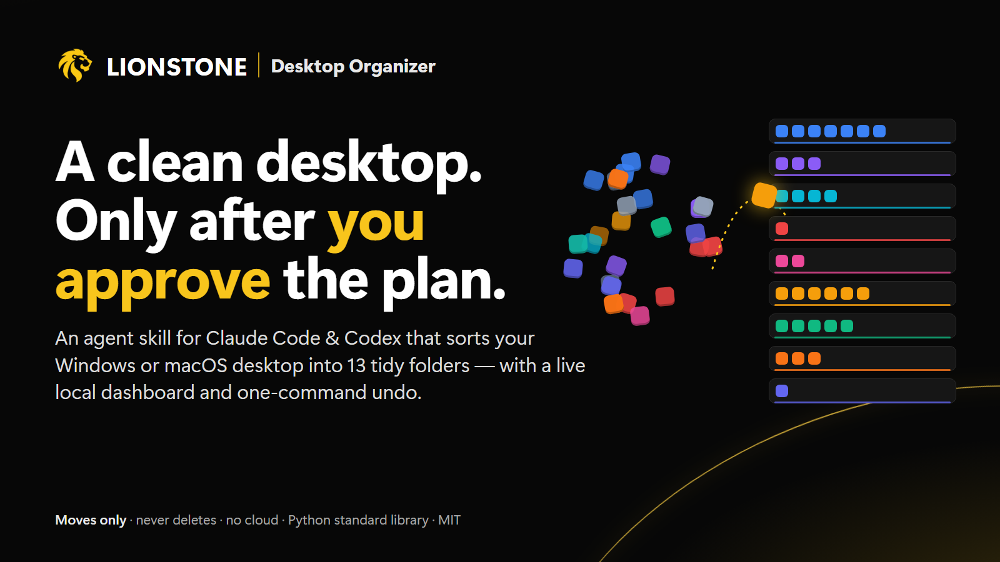
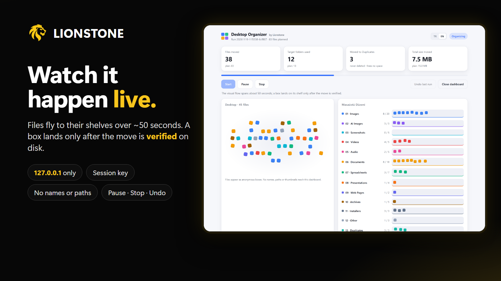
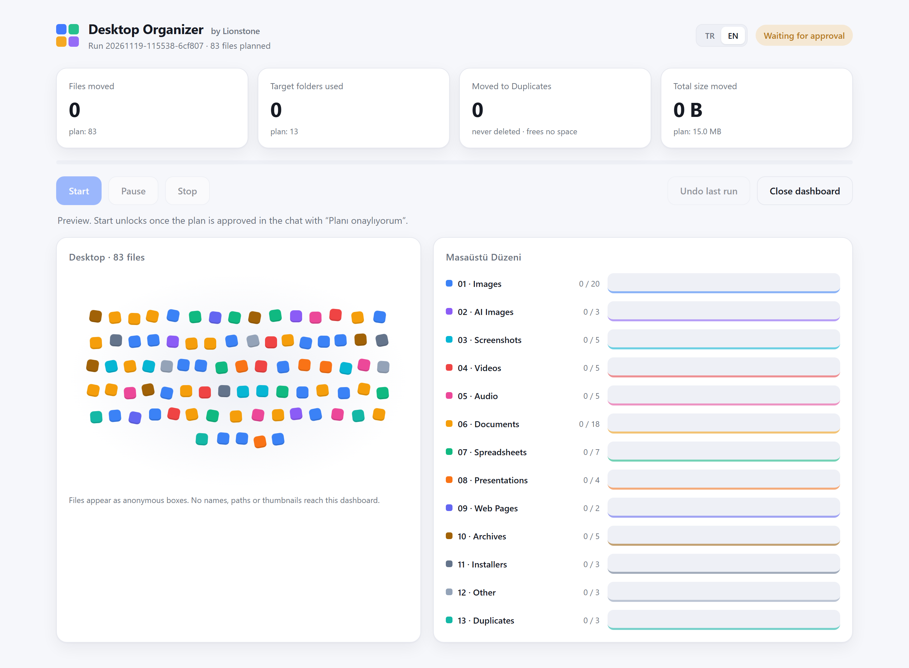
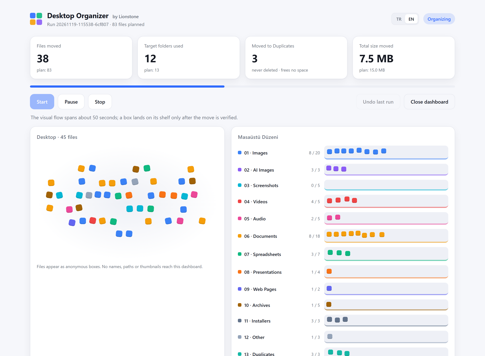
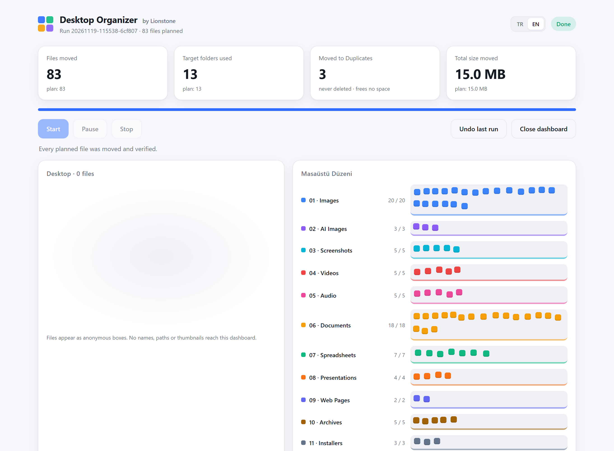
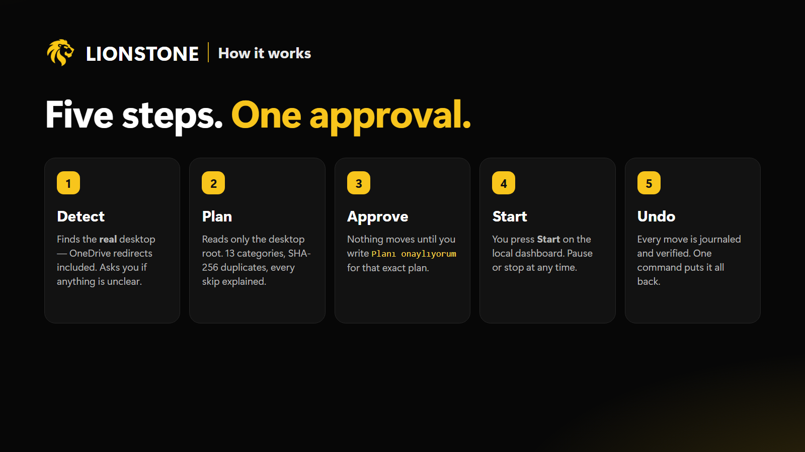
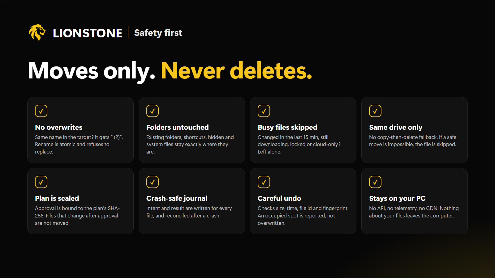
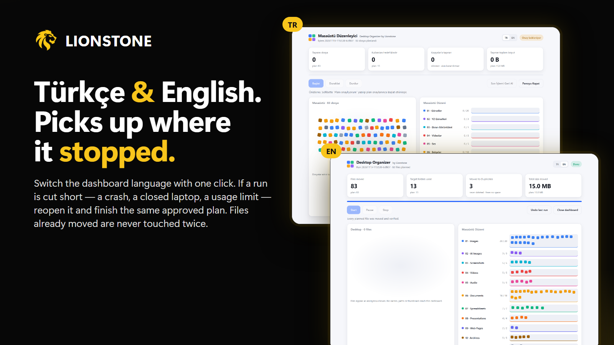

<p align="center">
  
</p>

<h1 align="center">Desktop Organizer <sub>by Lionstone</sub></h1>

<p align="center">
  <b>An agent skill for Claude Code and Codex that tidies your Windows or macOS desktop<br>
  into one folder with 13 categories — only after you approve a written plan.</b>
</p>

<p align="center">
  <a href="https://github.com/ismailarslantas/desktop-organizer/actions/workflows/tests.yml"></a>
  
  
  
  <a href="LICENSE"></a>
</p>

<p align="center">
  <a href="#install">Install</a> ·
  <a href="#how-it-works">How it works</a> ·
  <a href="#safety-model">Safety model</a> ·
  <a href="#command-reference">Commands</a> ·
  <a href="#undo-and-recovery">Undo &amp; recovery</a> ·
  <a href="docs/README.tr.md">Türkçe</a>
</p>

---

Ask your agent *“organize my desktop”* (or *“masaüstümü düzenle”*). It finds your **real** desktop,
reads the files in its root, and shows you a plan: what goes where, why, which files are
duplicates, and what it will leave alone. Nothing moves until you write **`Planı onaylıyorum`**
(“I approve the plan”) and press **Start** in a dashboard that runs only on your own computer.
Every move is journaled, verified and can be undone with one command.

- **Moves only.** Never deletes, never overwrites, never edits a file.
- **Your desktop stays yours.** No cloud, no API keys, no telemetry. Python standard library only.
- **Works where you work.** One `SKILL.md` and the same scripts for Claude Code and Codex.
- **Bilingual dashboard.** Türkçe and English, switchable with one click.
- **Picks up where it stopped.** A crash, a closed laptop or a usage limit doesn’t leave a mess.

## See it

<p align="center">
  
</p>

The dashboard opens in your browser at `127.0.0.1`. Files appear as anonymous coloured boxes —
**no names, paths or thumbnails** are ever sent to the page. Press **Start** and the boxes fly onto
labelled shelves over about 50 seconds. A box lands only after its move has been verified on disk,
so the animation never runs ahead of reality; if the real work takes longer, the dashboard waits.

| Preview (Start disabled) | Running | Done |
|---|---|---|
|  |  |  |

Counters at the top are exact: **files moved**, **target folders used**, **files moved to
Duplicates** and **total size moved**. (Moving duplicates does not free disk space, and the
dashboard never claims it does.) Controls: **Start**, **Pause / Resume**, **Stop**,
**Undo last run**, **Close dashboard**. Pause and Stop take effect after the file in flight
finishes; Stop never undoes what was already moved.

## How it works

<p align="center"></p>

1. **Detect** – finds the real desktop through the operating system, not a hard-coded path:
   `SHGetKnownFolderPath(FOLDERID_Desktop)` cross-checked with the registry on Windows
   (so OneDrive-redirected desktops work), `~/Desktop` on macOS, `xdg-user-dir` on Linux. The
   Public desktop is never touched. If anything is ambiguous, the agent stops and asks you.
2. **Plan** – scans **only the root** of the desktop. It does not enter, move or rename folders.
   Each file gets a category and a reason, duplicates are confirmed with SHA-256, name clashes get
   a ` (2)` suffix, and every skipped item is listed with why. The plan is saved under a unique
   operation id such as `20261119-115538-6cf807`.
3. **Approve** – you read the plan and reply `Planı onaylıyorum`. The approval is sealed to the
   SHA-256 of that exact plan file; editing the plan afterwards invalidates it. Files that appear
   later are never included.
4. **Start** – you press **Start** in the dashboard. The server can run only the approved plan and
   accepts no paths or commands from the browser.
5. **Undo** – one command (or one button) puts the files back, after checking each one is still
   the file that was moved.

### Target layout

```text
Desktop/
├── Masaüstü Düzeni/            ← the one folder this tool creates
│   ├── 01_Görseller            images
│   ├── 02_YZ Görselleri        AI-generated images (metadata or explicit file name only)
│   ├── 03_Ekran Görüntüleri    screenshots
│   ├── 04_Videolar             video
│   ├── 05_Ses                  audio
│   ├── 06_Belgeler             documents (pdf, docx, txt, md, …)
│   ├── 07_Tablolar             spreadsheets (xlsx, csv, numbers, …)
│   ├── 08_Sunumlar             presentations (pptx, key, …)
│   ├── 09_Web Sayfaları        saved web pages
│   ├── 10_Arşivler             archives (zip, rar, 7z, tar.gz, …)
│   ├── 11_Kurulum              installers & disk images (exe, msi, dmg, pkg, iso, …)
│   ├── 12_Diğer                everything else
│   └── 13_Kopyalar             extra copies of identical files
├── Your existing folders/      untouched
└── Your shortcuts (.lnk .url .webloc .desktop)   untouched
```

Folder names are Turkish by design (the project started as *Masaüstü Düzenleyici*). Only the
category folders that are actually needed get created, and later runs reuse the same layout.

### How files are classified

| Signal | Used for |
|---|---|
| File extension | The main rule for every category |
| Safe header check (first bytes only) | Confirms raster images and PDFs; an `.png` that is really text goes to *Other*; files without an extension are sniffed |
| File name markers (`Screenshot`, `Ekran Görüntüsü`, `Bildschirmfoto`, …) and screenshot-tool metadata | Screenshots |
| Generator metadata — Stable Diffusion `parameters`, ComfyUI `prompt`/`workflow`, C2PA / IPTC `trainedAlgorithmicMedia`, Midjourney/DALL·E/Firefly tags — or an explicit file name (`DALL·E …`, `Gemini_Generated_Image…`) | AI images |
| Nothing conclusive | Images go to *Images*, unknown types to *Other* |

Images are **never** judged by how they look, and file contents are never sent anywhere.

**Duplicates:** files are grouped by size, then compared with SHA-256 — a shared name alone is
never a duplicate. In each group the file with the **oldest modification time** (then the shortest
name, then alphabetical) goes to its normal category; the rest go to `13_Kopyalar`.

## Safety model

<p align="center"></p>

**Never touched:** folders · shortcuts · hidden and system files (`desktop.ini`, `.DS_Store`, …) ·
symbolic links, junctions and their targets · the Recycle Bin / This PC icons · icon positions,
wallpaper and OS settings · the Public desktop.

**Skipped, with the reason shown in the plan:**

- modified in the last **15 minutes**;
- temporary or half-downloaded (`.crdownload`, `.part`, `.partial`, `.download`, `.tmp`, …);
- size or modification time changed between two checks a moment apart;
- locked, unreadable, or **cloud-only** (OneDrive “Files On-Demand”, iCloud “Optimise Storage”) —
  the tool reads attributes first and never triggers a download;
- an HTML page that has a companion `name_files` folder (moving one without the other would break
  the page, and folders are off-limits);
- changed after the plan was approved — it is set aside for a new review.

**How a move happens:**

1. The source is re-checked: still a regular file in the desktop root, same size, modification
   time, file id and content fingerprint as in the plan.
2. The target is re-checked: inside `Masaüstü Düzeni/<category>`, not a link, on the same drive.
3. An **intent record** is written to the journal and flushed to disk (`fsync`).
4. The file is renamed with an operation that **refuses to overwrite** (`MoveFileExW` without
   `REPLACE_EXISTING` on Windows, `renamex_np(RENAME_EXCL)` on macOS,
   `renameat2(RENAME_NOREPLACE)` on Linux). There is **no copy-then-delete fallback**: if the
   target is on another drive, the file is skipped.
5. The result is verified and recorded.

Only one organize or undo run can happen at a time (a lock in the app-data folder).

### Dashboard security

- Binds to `127.0.0.1` on a free port chosen by the OS — never `0.0.0.0`, never the LAN.
- A random per-session key is required on every API call, and `Host`, `Origin` and
  `Sec-Fetch-Site` are checked, so other local pages and processes can’t drive it.
- A strict Content-Security-Policy; no CDN, web fonts, analytics or external requests of any kind.
- The browser can only say *start / pause / stop / undo last / close* — it can’t pass a path, a
  file or a command. The server runs only the plan you approved.

## Install

You need **Python 3.9+** (already on most Macs; on Windows install it from python.org or the
Microsoft Store). Nothing else — the tool uses only the standard library and **never installs
anything by itself**. The repository root *is* the skill folder (it contains `SKILL.md`).

### Claude Code (desktop app or CLI)

Personal skill, available in every project:

```bash
git clone https://github.com/ismailarslantas/desktop-organizer.git ~/.claude/skills/desktop-organizer
```

On Windows (PowerShell):

```powershell
git clone https://github.com/ismailarslantas/desktop-organizer.git "$env:USERPROFILE\.claude\skills\desktop-organizer"
```

Or per project: clone into `<project>/.claude/skills/desktop-organizer`. Start a new session and
ask *“organize my desktop”*, or type `/desktop-organizer`.

### Codex (CLI, IDE extension or app)

```bash
git clone https://github.com/ismailarslantas/desktop-organizer.git ~/.codex/skills/desktop-organizer
```

On Windows (PowerShell):

```powershell
git clone https://github.com/ismailarslantas/desktop-organizer.git "$env:USERPROFILE\.codex\skills\desktop-organizer"
```

Restart Codex, then ask *“organize my desktop”* or mention `$desktop-organizer`.

### Both, from one copy

Clone once and link it into both places so updates apply everywhere:

```bash
git clone https://github.com/ismailarslantas/desktop-organizer.git ~/skills/desktop-organizer
ln -s ~/skills/desktop-organizer ~/.claude/skills/desktop-organizer
ln -s ~/skills/desktop-organizer ~/.codex/skills/desktop-organizer
```

On Windows use a directory junction (no admin rights needed):

```powershell
git clone https://github.com/ismailarslantas/desktop-organizer.git "$env:USERPROFILE\skills\desktop-organizer"
cmd /c mklink /J "%USERPROFILE%\.claude\skills\desktop-organizer" "%USERPROFILE%\skills\desktop-organizer"
cmd /c mklink /J "%USERPROFILE%\.codex\skills\desktop-organizer" "%USERPROFILE%\skills\desktop-organizer"
```

Check your setup at any time (reads only, installs nothing):

```bash
python ~/.claude/skills/desktop-organizer/scripts/masaustu.py env
```

> Installing the skill is **not** permission to move files. The agent will always show you the
> plan and wait for `Planı onaylıyorum` first.

## Command reference

The agent runs these for you, but you can use them directly too. Every command has a Turkish name
and an English alias (`plan` is the same in both). Examples use `python`; use `python3` or
`py -3` if that’s what your system has.

```bash
S=~/.claude/skills/desktop-organizer/scripts      # or ~/.codex/skills/…

python $S/masaustu.py env                          # OS, Python, detected desktop (alias of: ortam)
python $S/masaustu.py detect                       # just the desktop path       (tespit)
python $S/masaustu.py plan                         # scan + save plan + print it
python $S/masaustu.py approve 20261119-115538-6cf807 --phrase "Planı onaylıyorum"   # (onayla … --ifade)
python $S/masaustu.py dashboard 20261119-115538-6cf807                              # (pano)
python $S/masaustu.py undo --last                  # undo the most recent run     (geri-al --son)
python $S/masaustu.py undo 20261119-115538-6cf807  # undo a specific run          (geri-al <id>)
python $S/masaustu.py status                       # all runs, remaining files   (durum)
python $S/masaustu.py reconcile                    # repair half-written records (uzlastir)
```

Useful options: `plan --desktop <path>` (only for a path *you* choose, e.g. a test folder),
`dashboard --seconds 50` (length of the visual flow), `dashboard --no-browser` (print the URL
instead of opening a browser).

## Undo and recovery

**Undo** checks every file before moving it back — size, modification time, file id and a content
fingerprint. Then:

- original spot empty → the file goes back;
- original spot **taken** → the file stays where it is and the conflict is reported (nothing is
  overwritten; fix it and run undo again — it retries only what’s left);
- file **changed or moved** since → it is not forced back.

Undo never deletes files or folders — the empty category folders stay.

**Interrupted runs.** If a run is cut short — the app crashes, the laptop sleeps, the dashboard is
closed, or the agent hits a usage limit — just come back later. `status` shows the run as
unfinished, and opening the dashboard for the same id offers **Resume where it stopped**. It uses
the same approved plan (no new approval), skips every file that was already moved, and re-checks
each remaining file before moving it. Half-written journal entries are reconciled with what is
actually on disk first.

<p align="center"></p>

**Where the records live** (never on the desktop):

| OS | Folder |
|---|---|
| Windows | `%LOCALAPPDATA%\MasaustuDuzenleyici` |
| macOS | `~/Library/Application Support/MasaustuDuzenleyici` |
| Linux | `$XDG_STATE_HOME/masaustu-duzenleyici` (default `~/.local/state/…`) |

Inside: `planlar/` (plans as JSON + Markdown, approvals) and `islemler/<id>/gunluk.jsonl`
(the journal: source, target, size, time, file id, fingerprint, result or error for every file).

## Tested

`tests/test_duzenleyici.py` runs every scenario in a **temporary sample desktop** — it never
touches your real one:

| Scenario | Checked |
|---|---|
| Normal files | All 13 categories, header sniffing, screenshot and AI markers in names and metadata |
| Duplicates | Size + SHA-256 grouping, oldest file kept in its category, same name ≠ duplicate |
| Name collisions | Existing target gets ` (2)`, nothing overwritten |
| New / changing files | Edited in the last 15 min, changed after approval, appeared after the plan |
| Partial downloads | `.crdownload`, `.part`, `.tmp` skipped |
| Shortcuts & folders | `.lnk`/`.url` and existing folders untouched; no layout folder created when idle |
| Links | Symlinks skipped; a linked `Masaüstü Düzeni` is refused |
| Approval | Wrong phrase, missing approval and a tampered plan all refuse to move |
| Pause / stop / concurrency | Pause holds between files, stop keeps moved files, two runs can’t overlap |
| Undo conflicts | Occupied original spot and modified files are left in place and reported |
| Crash recovery | A move that finished without its record is reconciled and undoable |
| Resume | An interrupted run continues with the same plan without re-touching moved files |
| Dashboard | Loopback only, key / Host / Origin checks, no names or paths in the API, no external URLs in the assets |

Run them yourself:

```bash
python -m unittest discover -s tests -v
```

GitHub Actions runs the suite on **Windows, macOS and Ubuntu** with Python 3.9 and 3.13 on every
push.

## Known limitations

- **Locked files on macOS/Linux:** these systems have no mandatory file locks, so a file that
  another app has open may still be moved (the app keeps its handle). Windows reports real
  sharing violations and such files are skipped.
- **Cloud folders:** cloud-only placeholders are detected from OneDrive attributes and iCloud’s
  “dataless” flag. Other sync tools may not expose this; their files are moved like local files
  when fully downloaded.
- **Symbolic-link test on Windows** is skipped unless Developer Mode or admin rights allow
  creating symlinks (junctions are still tested).
- **Linux** is supported on a best-effort basis (XDG desktop); the skill targets Windows and macOS.
- Category folder names are Turkish.

## Regenerating the images

All images in `docs/images` are rendered from HTML with headless Chrome or Edge, using a
throw-away sample desktop:

```bash
python tools/make_promo.py            # dashboard screenshots + promo slides
python tools/make_promo.py --slides-only
```

## Project layout

```text
SKILL.md                 shared instructions for Claude Code and Codex
scripts/masaustu.py      command line (Turkish commands + English aliases)
scripts/duzen_cekirdek.py  detection, classification, plan, safe move, journal, undo
scripts/duzen_pano.py    local dashboard server (127.0.0.1)
assets/pano/             dashboard page (HTML/CSS/JS, no external files)
tests/                   scenario tests on a temporary desktop
tools/make_promo.py      image generator
docs/README.tr.md        Turkish guide
```

## License

[MIT](LICENSE) © 2026 Lionstone. Part of the [Lionstone](https://github.com/ismailarslantas/lionstone) family of local-first tools.
